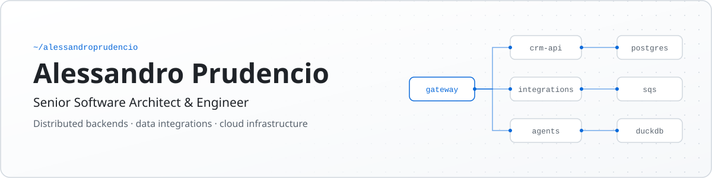

<picture>
  <source media="(prefers-color-scheme: dark)" srcset="assets/banner-dark.svg" />
  
</picture>

   
  
  
  

I design and build systems that have to keep working as they grow: enterprise CRMs, ERP and data integrations, event-driven microservices and the AWS infrastructure underneath them. Most of my work is in TypeScript and Node.js, with Go and Python where they fit better.

Lately I have been focused on analytical workloads with DuckDB and on putting LLM agents into production flows, where they have to be observable, cheap and predictable.

## Featured work

<table>
  <tr>
    <td width="50%" valign="top">
      <h3><a href="https://github.com/alessandroprudencio/ale-flix">AleFlix</a></h3>
      Video streaming platform: upload, queue-driven transcoding, adaptive HLS playback and distributed tracing.
        
      <code>Nuxt 3</code> <code>NestJS</code> <code>PostgreSQL</code> <code>Redis</code> <code>S3</code> <code>SQS</code> <code>ffmpeg</code> <code>Jaeger</code>
    </td>
    <td width="50%" valign="top">
      <h3><a href="https://github.com/alessandroprudencio/TP-Api-Gateway">Tennis Player</a></h3>
      API Gateway in front of four microservices talking over a message broker, with a CI/CD pipeline to ECS.
        
      <code>NestJS</code> <code>RabbitMQ</code> <code>MongoDB</code> <code>Cognito</code> <code>ECS</code> <code>CodePipeline</code>
    </td>
  </tr>
  <tr>
    <td width="50%" valign="top">
      <h3><a href="https://github.com/alessandroprudencio/aws-elasticache-redis-lambda">Lambda + ElastiCache in a VPC</a></h3>
      Network setup for a Lambda reaching Redis in private subnets, plus an ElastiCache vs. MemoryDB latency benchmark.
        
      <code>AWS Lambda</code> <code>ElastiCache</code> <code>MemoryDB</code> <code>VPC</code>
    </td>
    <td width="50%" valign="top">
      <h3><a href="https://github.com/alessandroprudencio/tcompany-terraform">Kubernetes with Terraform</a></h3>
      Kubernetes cluster on AWS provisioned end to end as code.
        
      <code>Terraform</code> <code>Kubernetes</code> <code>AWS</code>
    </td>
  </tr>
</table>

## Stack

<table>
  <tr>
    <td width="50%" valign="top">
      <h3>Backend</h3>
      
    </td>
    <td width="50%" valign="top">
      <h3>Data</h3>
      
       plus DuckDB and AWS SQS
    </td>
  </tr>
  <tr>
    <td width="50%" valign="top">
      <h3>Cloud & Infra</h3>
      
       Lambda, ECS, S3, ElastiCache, Cognito
    </td>
    <td width="50%" valign="top">
      <h3>Frontend</h3>
      
    </td>
  </tr>
  <tr>
    <td colspan="2">
      <h3>AI</h3>
      LLM agents · OpenAI · Groq
       
    </td>
  </tr>
</table>
